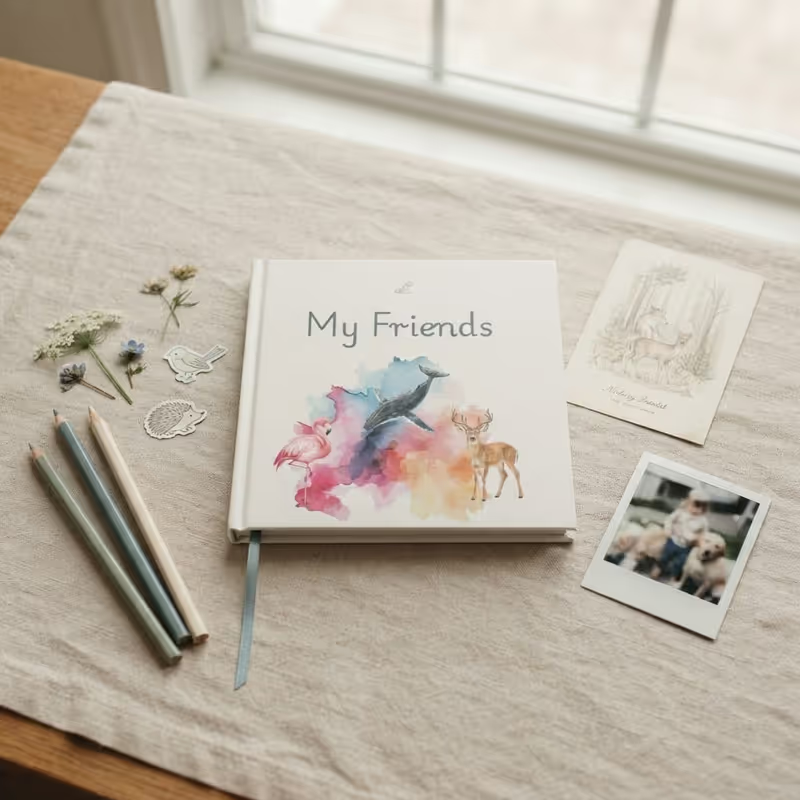

Most gifts are forgotten by next week. A friend book fills up with the handwriting of every friend your child loves, one page at a time — as long as each friend knows what to put on their page.

Childhood friendships are full of small moments that fade faster than anyone expects. A friend book gives those moments a home, and a few good friend book ideas turn a blank page into a memory, a sketch, or a message in a friend's own handwriting.

The examples below use the [animal-themed friend book](/friend-book/animals/) from Album Amicorum's My Friends Book collection: soft, earthy watercolors around cream pages that stay blank for friends to complete. The ideas work just as well in any edition.

## Why Open Pages Need a Few Ideas

Between the illustrations, the pages stay blank on purpose. Nothing is filled in ahead of time. Each friend gets a page of their own to write a memory, add a drawing, name a favorite thing, or leave a message meant for just one person.

That freedom keeps every book different. Two children can own the same edition and end up with completely different stories, because every friendship has its own details. It also means a friend holding the pen for the first time may freeze. A short list of ideas fixes that.

## Friend Book Ideas: What Friends Can Write

Words are what children look back on most. These prompts are short enough for a seven-year-old and still say something real:

- **A shared memory.** A funny moment from a playdate, a class trip, or a birthday — the more specific, the better.
- **Favorites, in their own hand.** A favorite food, color, song, game, or book, so the page captures who they are right now.
- **"You are the friend who…"** One sentence that finishes the thought. It is easy to start and often surprisingly sweet.
- **A wish or a promise.** A short private message for the book's owner, like a wish for next year or a promise to stay friends.
- **Something only they know.** An inside joke, a nickname, or the name of the game they made up together.

## Friend Book Ideas: What Friends Can Draw

Drawing takes the pressure off, and in an illustrated book it fits right in:

- **Their favorite animal**, with one line on why they love it. In the Animals edition this almost writes itself.
- **A self-portrait**, so years later your child can see how each friend saw themselves.
- **The two friends together**, doing the thing they love doing most.
- **A small doodle in the margin** — a heart, a star, a pet — next to whatever they wrote.

For more prompts to read aloud while the book goes around, our list of [friendship questions for kids](/articles/friendship-questions-for-kids/) works as a ready-made page starter.

## How to Get the Book Started

Fill in a page first, or let your child do it, so friends can see what a finished page looks like. Then pass the book to one friend at a time. A relaxed setting helps — a weekend afternoon or a quiet corner at a party both work well. If you are setting up the very first pages, here is [how to start a friendship book](/articles/how-to-start-a-friendship-book-for-kids/) step by step.

Give each friend one simple idea from the lists above, such as their favorite animal or the best day they spent together. There is nothing to charge and nothing to swipe, so the book never competes with a screen for attention.

## Helping Shy and Younger Friends Join In

Some friends feel nervous about writing in a book that belongs to someone else. Younger friends may find writing difficult, so let them draw instead — a drawing of a favorite animal says plenty on its own. An adult can add a one-line caption the child dictates.

Share the book in a small group so nobody feels watched, and give each person time to think. A relaxed page often turns out more heartfelt than a rushed one.

## Occasions That Suit a Friend Book

A friend book suits a birthday, a class gift, or a present for a new friend settling in. A few situations where it fits especially well:

- A child who loves animals and wants to share that interest with friends.
- A parent who wants a birthday present that feels more personal than a toy.
- A teacher or class parent choosing a gift that classmates can complete together.
- A family welcoming a new friend who is still finding their place at school or in the neighborhood.

## How It Compares With Other Ways to Save Memories

Families have a few options for collecting friendship memories, and each works a little differently. The table below shows how they line up.

| Option | Handwriting from friends | Each friend writes their own page | Screen needed |
|---|---|---|---|
| Friend book | Yes | Yes, by design | No |
| Plain notebook | Yes | Only if you set it up that way | No |
| Digital message collection | No, usually typed | Yes | Yes |

A plain notebook is flexible and works for anything from school notes to a private diary. A digital collection can suit friends who live far apart, since nobody has to mail a book across the country. A friend book is slower by design and works best when friends can meet in person.

Not every child is wild about animals. If space, dinosaurs, or fairies are bigger favorites, the same book also comes in Space, Dinosaurs, Fairies, Mermaids, Flowers, and Forest editions. You can browse them all in the [My Friends Book collection](/friend-book/).

## Why the Finished Book Stays

A notebook gets finished and cleared out. A friend book is meant to stay. As it fills, it becomes a record of friendship in real handwriting, with wobbly drawings, crooked hearts, and favorite words spelled in unique ways.

Those details tend to mean more as the years pass. The best friend book is the one that actually gets filled — passed from hand to hand until every page has a voice. A pen, a few friends, a handful of ideas, and some quiet time are all it takes.

## Where Things Stand
<!-- WHERE-THINGS-STAND:START -->
Interest in a more hands-on, screen-light childhood keeps building in 2026. Since January, Alabama, Tennessee, Utah and Virginia have passed some form of legislation limiting screen time in classrooms, and more than 10 other states are considering similar rules. In Los Angeles, the school board unanimously approved one of the nation's strictest policies, banning screen use during the school day for preschool, transitional kindergarten and first-grade students from the 2026–27 school year. Families are moving the same way at home: craft retailer Michaels reported that searches for "analog hobbies" on its site rose 136% in six months. A book that friends fill in by hand fits squarely into that shift — an activity children do together, with nothing to charge and a finished page they can keep.
<!-- WHERE-THINGS-STAND:END -->

## Key Takeaways
- The best friend book ideas are specific and short: a shared memory, a favorite thing, a one-line "you are the friend who…", or a wish for the book's owner.
- Drawing prompts — a favorite animal, a self-portrait, the two friends together — take the pressure off and suit younger friends who are still learning to write.
- Filling in the first page yourself shows every friend what a finished page looks like and makes the blank page less intimidating.
- Passing the book one friend at a time, in a relaxed setting, produces more heartfelt pages than a rushed group session.
- The same ideas work in every My Friends Book edition; the Animals edition simply makes "draw your favorite animal" an easy place to start.
